# Pipeline Big Data — Matrícula de Educación Superior en Colombia (2015–2021)

**Institución Universitaria Pascual Bravo** · **Gestión de Datos Masivos (G004 — Unidad 3)**  
**Docente:** Aleixo Eder Pineda Ramírez · **Periodo:** 2026-2  
**Estudiantes:** **Camilo Zuleta Delgado** · **Santiago Restrepo Silva**

[](#arquitectura-lambda-y-justificación)
[-0f766e)](https://www.datos.gov.co/d/5wck-szir)
[%20%2B%20Airflow%20(%2B3)-d97706)](#componentes-opcionales-5-pts)

---

## 1. Problema, Pregunta Principal y Usuario Objetivo (Fase 1)

### Pregunta de investigación
> **¿Cómo evolucionó la matrícula de educación superior en Colombia (2015–2021) por departamento, sector (oficial vs. privado), metodología (presencial/virtual/distancia), área del conocimiento y género, y cuál es la brecha regional y de Antioquia frente al país?**

### Usuario objetivo
- **Direcciones de Planeación Académica de Instituciones de Educación Superior (IES)** (en particular la **Institución Universitaria Pascual Bravo**, código SNIES `3107`), para tomar decisiones basadas en evidencia sobre apertura de programas virtuales, reducción de brecha de género en STEM y posicionamiento regional.
- **Secretarías de Educación Departamentales** (ej. Antioquia) y analistas de política pública educativa que requieren monitorear concentración territorial y equilibrio entre oferta oficial y privada.

### Fuente de datos pública (API abierta sin credenciales)
| Atributo | Valor |
| --- | --- |
| Portal oficial | [Datos Abiertos Colombia — `MEN_MATRICULA_ESTADISTICA_ES`](https://www.datos.gov.co/d/5wck-szir) |
| Entidad propietaria | Ministerio de Educación Nacional (MEN — SNIES) |
| Endpoint SODA2 (abierto) | `https://www.datos.gov.co/resource/5wck-szir.json` |
| Volumen crudo descargado | **390.903 registros**, 26 columnas, 14 semestres (`2015-1` a `2021-2`) |
| Volumen curado único | **230.082 registros**, **16.773.503** matrículas acumuladas, **338** IES, **15.526** programas, **33** deptos DANE |
| Llave natural (`id_registro`) | `anio\|semestre\|cod_ies\|cod_snies\|cod_muni_oferta(5d)\|id_metodologia\|id_genero` |

> **¿Por qué SODA2 y no SODA3?** En la interfaz de exportación de `datos.gov.co`, el endpoint v3 (`/api/v3/views/5wck-szir/query.json`) exige autenticación; el endpoint estándar SODA2 (`/resource/5wck-szir.json`) devuelve los mismos 390.903 registros de forma pública con paginación `$limit`, `$offset` y `$where` (opcionalmente acelerable con `SOCRATA_APP_TOKEN` en `.env`).

---

## 2. Arquitectura Lambda y Justificación

### Diagrama de arquitectura (Zonas `Raw → Curada → Servicio`)

```mermaid
flowchart LR
    API["API SODA2 datos.gov.co<br/>MEN 5wck-szir (390.903 filas)"] -->|"Fase 2: Paginación + Sobre JSON<br/>+ Manifiesto + Marca de agua"| RAWL["Zona RAW Local<br/>data/raw/*.jsonl"]
    RAWL -->|"Fase 3: Productor Python<br/>key=id_registro + .kafka_ok"| KAFKA["Apache Kafka 4.1 KRaft<br/>raw.datos_gov_co (3 particiones)"]

    %% Capa Batch
    KAFKA -->|"Fase 4a: Consumidor por lotes<br/>WebHDFS + commit manual"| HDFS_RAW["HDFS Zona RAW<br/>/datalake/raw/ (25 archivos, 401.58 MB)"]
    HDFS_RAW -->|"Fase 4b: Validación cruzada"| MR["MapReduce Python vs PySpark<br/>0 diferencias en 390.903 filas"]
    HDFS_RAW -->|"Fases 5-6: PySpark Curación<br/>Deduplicación + Catálogos DANE<br/>+ 5 Validaciones Fail-Fast"| HDFS_CUR["HDFS Zona CURADA<br/>Parquet por anio (5.66 MB · 70.92x)"]
    HDFS_CUR -->|"Opcional (+2 pts)"| HIVE["Apache Hive 4.0.1<br/>Tabla externa + 4 SQL analíticas"]
    HDFS_CUR -->|"Fase 8a: JDBC batch"| PG["PostgreSQL 17 Zona SERVICIO<br/>esquema servicio.* (usuario lector)"]

    %% Capa Velocidad (Speed)
    KAFKA -->|"Fase 7: Spark Structured Streaming<br/>watermark 5m + ventana 10m<br/>+ checkpoint persistente"| STREAM["Capa Rápida Lambda<br/>servicio.stream_ventanas (47 filas)"]
    STREAM --> PG

    %% Capa Servicio
    PG -->|"Fase 8b: Lectura solo lectura"| DASH["Tablero HTML Plotly.js<br/>salida/dashboard.html · docs/index.html"]

    %% Orquestación
    AF["Apache Airflow 3.3.2 (+3 pts)<br/>DAG 11 tareas + reintentos"] -.->|"Orquesta extremo a extremo"| RAWL
```



```text
[API SODA2 5wck-szir] ─► [RAW Local JSONL] ─► [Apache Kafka (3 particiones)]
                                                   │
                 ┌─────────────────────────────────┴─────────────────────────────────┐
                 │ CAPA BATCH (exactitud histórica)                                  │ CAPA VELOCIDAD (casi tiempo real)
                 ▼                                                                   ▼
      [HDFS /datalake/raw] ──► [MapReduce vs Spark (0 dif.)]         [Spark Structured Streaming]
                 │                                                     watermark 5m + ventana 10m
                 ▼                                                     checkpoint persistente
      [PySpark Curación + 5 Validaciones Fail-Fast]                                  │
                 │                                                                   │
                 ▼                                                                   │
      [HDFS /datalake/curated (Parquet 5.66 MB)] ──► [Apache Hive (+2)]              │
                 │                                                                   │
                 └─────────────────────────► [PostgreSQL 17: servicio.*] ◄───────────┘
                                                       │
                                                       ▼
                                    [Tablero Interactivo Plotly HTML / GitHub Pages]
                     (Orquestación opcional +3 pts: Apache Airflow 3.3.2 — DAG 11 tareas)
```

### ¿Por qué Arquitectura Lambda y no Kappa?
1. **Necesidad real de la Capa Batch:** La fuente oficial del MEN presenta anomalías estructurales complejas en el histórico 2015–2019 (**160.821 duplicados** —incluyendo **54.225 duplicados ocultos** por diferencias de comas en los textos de programas— y **90 grafías distintas** para 33 departamentos). Reprocesar todo el histórico en **PySpark** garantiza deduplicación exacta con ventanas sobre `id_registro`, normalización canónica contra catálogos DANE/SNIES, compresión **Parquet 70,92×** más eficiente y consultas SQL en **Hive**.
2. **Necesidad real de la Capa de Velocidad:** Al conectar **Spark Structured Streaming** directamente a **Kafka** con `watermark` de 5 minutos, ventana de 10 minutos, `dropDuplicatesWithinWatermark(["id_registro"])` y `checkpoint` persistente, los nuevos lotes entrantes actualizan `servicio.stream_ventanas` en segundos y se reconcilian automáticamente con Batch (**0 diferencias** en los 7 años: `16.773.503` matriculados en ambas capas).
3. **Por qué no Kappa pura:** En Kappa todo depende de reproducir el log de Kafka desde el inicio; en un escenario de datos públicos gubernamentales donde la retención de Kafka es finita (7 días) y las auditorías exigen reprocesos deterministas sobre HDFS inmutable (`raw`), **Lambda** ofrece el mejor equilibrio entre trazabilidad, exactitud analítica y baja latencia.

---

## 3. Hallazgos Reales de Calidad de Datos y Resultados Analíticos

### Limpieza y calidad de datos (Fases 5 y 6 — evidencia real)
Durante la exploración y curación de `5wck-szir` se detectaron y resolvieron **5 problemas reales** de la fuente oficial:

| Problema real detectado en `datos.gov.co` | Impacto en crudo | Solución implementada en `procesamiento/transformaciones.py` |
| --- | --- | --- |
| **Duplicación 2× en 2015–2019** (el MEN cargó los periodos dos veces) | `390.903` filas raw → **`160.821` duplicados (41,1%)**: `106.596` exactos + **`54.225` ocultos** donde solo cambian comas en el texto del programa | Llave natural `id_registro` + `Window.partitionBy("id_registro")` determinista (un `dropDuplicates()` ingenuo habría dejado 54.225 duplicados). |
| **90 nombres sucios para 33 departamentos** (`BOGOTA D.C`, `Bogotá, D.C.`, `NARINIO`, `ARCHIPIÉLAGO DE SA`) y códigos DANE sin cero inicial (`5` vs `05`) | Gráficos fragmentados y cruces rotos por departamento | Normalización con `lpad(2)` / `lpad(5)` y diccionario canónico DANE (`procesamiento/catalogo.py`) → exactamente **33 departamentos válidos**. |
| **Texto `"Sin clasificar"` en `id_area`** (192 registros) | Fallo de casteo en Spark 4 (modo ANSI estricto) | `try_cast` a entero + `coalesce(..., 0)` → `"Sin clasificar"`. |
| **Columna `matriculados_2015` contiene TODOS los años 2015–2021** | Nombre engañoso en la API del MEN | Renombrada a `total_matriculados` (`INT`) y validada en rango `>= 0`. |
| **Tamaño excesivo en texto plano JSONL** | `401,58 MB` (`421.091.784 B`) en HDFS raw | Conversión a **Parquet + Snappy** particionado por `anio` → **`5,66 MB`** (`5.937.414 B`): **70,92× menos espacio (98,6% de ahorro)**. |

#### Antes y después por año (`evidencias/reporte_calidad.json`)
| Año | Filas RAW | Duplicados eliminados | Filas Curadas | Matriculados Curados |
| --- | ---: | ---: | ---: | ---: |
| 2015 | 59.146 | 29.573 | 29.573 | 2.293.550 |
| 2016 | 62.038 | 31.019 | 31.019 | 2.394.434 |
| 2017 | 65.464 | 32.732 | 32.732 | 2.446.314 |
| 2018 | 64.104 | 32.056 | 32.048 | 2.440.363 |
| 2019 | 70.864 | 35.432 | 35.432 | 2.396.250 |
| 2020 | 34.725 | 4 | 34.721 | 2.355.153 |
| 2021 | 34.562 | 5 | 34.557 | 2.447.439 |
| **Total** | **390.903** | **160.821** | **230.082** | **16.773.503** |

**Validaciones automáticas fail-fast (`procesamiento/calidad.py`):** **5 / 5 APROBADAS** (`conteo_mayor_cero`, `sin_nulos_columnas_clave`, `sin_id_registro_duplicados`, `rangos_validos`, `departamentos_dane_canonicos`).

### Respuesta a la pregunta principal (hallazgos reales)
1. **Resiliencia post-pandemia:** La matrícula nacional del Semestre 1 creció **+6,8%**, de **1.867.703** (`2015-1`) a **1.994.383** (`2021-1`), absorbiendo la caída pandémica de `2020-1` (`1.930.613`) con plena recuperación en `2021-1` (impulsada por el sector oficial, que pasó de `778.911` a `880.728`).
2. **Auge estructural de la virtualidad (+274,7%):** Pasó de **63.569** (`3,40%` en `2015-1`) a **238.209** (`11,94%` en `2021-1`), y alcanzó el **30,19%** en el reporte `2021-2` (oferta SENA).
3. **Concentración regional y perfil de Antioquia:** Bogotá D.C. (`618.804` en `2021-1`) y **Antioquia** (`267.463`, **13,41%** del país, #2 nacional) concentran casi la mitad de la matrícula; sin embargo, Antioquia presenta una oferta significativamente más pública (**50,8% oficial** en Sem 1 y **58,9% anual**, frente a **20,1% oficial** en Bogotá D.C.).
4. **Brecha de género en STEM:** Aunque las mujeres representan el **53,84%** de la matrícula total (`2021-1`) y lideran en Salud (`69,40%`), Educación (`62,69%`), Ciencias Sociales (`62,23%`) y Economía (`59,19%`), en **Ingeniería, Arquitectura, Urbanismo y Afines** apenas alcanzan el **32,20%** (`159.638` mujeres vs. `336.091` hombres).
5. **Caso I.U. Pascual Bravo (código SNIES `3107`):** Creció **+88,8%** entre `2015-1` y `2021-1` (de **4.184** a **7.898** estudiantes, de `23` a `38` programas activos) y elevó la participación femenina de **18,07%** a **25,26%**.

---

## 4. Estructura del Repositorio

```text
pipeline-datos-gestion/
├── ingesta/                  # Fase 2 y 6: Cliente SODA2 paginado, sobre JSON, manifiesto y marca de agua
├── streaming/                # Fase 3: Creación tópico Kafka (3 part.), productor (.kafka_ok) y consumidor
├── datalake/                 # Fase 4a: Cliente WebHDFS y consumidor por lotes con commit manual
├── mapreduce/                # Fase 4b: Mapper/Reducer Python (stdin/stdout) y validador vs. PySpark
├── procesamiento/            # Fases 5, 6 y 8a: Catálogo DANE/SNIES, curación PySpark, calidad fail-fast y carga PG
├── streaming_spark/          # Fase 7: Spark Structured Streaming (Kafka -> watermark/ventana/checkpoint -> PG)
├── postgres/                 # Fase 8a: Esquema `servicio` y usuario de solo lectura `lector`
├── visualizacion/            # Fase 8b: Generador tablero HTML Plotly.js autocontenido (MIT + OFL local)
├── hive/                     # Opcional (+2 pts): DDL tabla externa Parquet + 4 consultas SQL analíticas
├── airflow/                  # Opcional (+3 pts): Dockerfile, init BD y DAG Airflow 3.3.2 (11 tareas)
├── orquestacion/             # Helper Docker SDK para el DAG de Airflow
├── jars/                     # JARs JDBC PostgreSQL y Kafka para Spark 4.0.2 (ejecución 100% offline)
├── tests/                    # Pruebas unitarias pytest (7 offline + 2 PySpark)
├── notebooks/                # Notebook ejecutado paso a paso (Fases 2 a 8 + Hive + Airflow)
├── datos_muestra/            # Muestra raw (200 filas), manifiestos, marca de agua y CSVs de zona de servicio
├── evidencias/               # Salidas reales verificadas de cada fase (Kafka, HDFS, MR, Calidad, Stream, Hive, Airflow)
├── salida/                   # dashboard.html y datos_tablero.json generados desde PostgreSQL
├── docs/                     # index.html (GitHub Pages), Guia_Completa_Ejecucion_Pipeline.pdf y Presentacion_Sustentacion.pdf
├── docker-compose.yml        # Orquestación de servicios con perfiles por fase (control de RAM)
└── actualizar.sh             # Script todo-en-uno para correr el pipeline end-to-end
```

---

## 5. Cómo Ejecutar Todo el Pipeline (Paso a Paso)

### Prerrequisitos
- **Docker Desktop** con al menos **4 GB de RAM** asignados (ideal 6–8 GB).
- **Python 3.9+** instalado en el equipo anfitrión.
- Conexión a internet únicamente para descargar la API de `datos.gov.co` (las dependencias de Spark están precargadas en `jars/`).

> **Nota sobre el puerto de PostgreSQL:** Para evitar conflictos con instalaciones locales de PostgreSQL en el puerto `5432`, el contenedor `matricula-postgres` se expone en el host por el puerto **`5433`** (`5433:5432`). Dentro de la red Docker (Spark y Airflow) sigue usando `postgres:5432`.

### Paso 0 — Entorno virtual de Python
**macOS / Linux:**
```bash
python3 -m venv .venv
source .venv/bin/activate
pip install -r requirements.txt
cp env.ejemplo .env   # Opcional: configurar SOCRATA_APP_TOKEN si se tiene
```

**Windows (PowerShell):**
```powershell
py -m venv .venv
.\.venv\Scripts\Activate.ps1
pip install -r requirements.txt
Copy-Item env.ejemplo .env
```

### Ejecución automática completa (macOS / Linux)
```bash
./actualizar.sh
```

### Ejecución fase por fase (recomendada para demostrar cada entregable)

#### Fase 2 y 6 — Ingesta desde API + Marca de agua incremental
```bash
# Corrida 1: descarga histórica hasta 2020 (356,341 filas -> marca de agua 2020-2)
python3 -m ingesta descargar --hasta-anio 2020

# Corrida 2: descarga incremental automática (34,562 filas de 2021 -> marca de agua 2021-2)
python3 -m ingesta descargar --incremental

# Corrida 3: prueba de idempotencia (0 registros nuevos)
python3 -m ingesta descargar --incremental
```

#### Fase 3 — Apache Kafka (tópico de 3 particiones, productor y consumidor)
```bash
docker compose --profile kafka up -d --wait
python3 -m streaming crear-topicos
python3 -m streaming producir                 # Corrida 1: 390,903 mensajes
python3 -m streaming producir                 # Corrida 2 (idempotencia): 0 mensajes (.kafka_ok)
python3 -m streaming info-topico              # Verifica distribución en particiones 0, 1 y 2
python3 -m streaming consumir --grupo grupo-verificacion --max 5
```

#### Fase 4a — Data Lake en HDFS (consumidor por lotes con commit manual)
```bash
docker compose --profile hdfs up -d --wait
python3 -m datalake consumir                  # Escribe 25 archivos por lote en /datalake/raw
python3 -m datalake resumen /datalake/raw
docker compose exec namenode hdfs dfs -ls -R -h /datalake/raw
```
*(Interfaz web HDFS disponible en `http://localhost:9870`)*

#### Fase 4b — MapReduce en Python vs. PySpark
```bash
docker compose run --rm spark-mapreduce
# Verifica coincidencia exacta (0 diferencias) sobre 390,903 registros y 28,745,704 matriculados raw
```

#### Fases 5 y 6 — Zona Curada en PySpark (Parquet + 5 Validaciones Fail-Fast)
```bash
docker compose run --rm spark
# Genera /datalake/curated/matricula_es/anio=2015..2021 (5.66 MB vs 401.58 MB raw = 70.92x)
# Guarda evidencia en evidencias/reporte_calidad.json
```

#### Fase 7 — Spark Structured Streaming (Capa de Velocidad Lambda + Prueba de Reinicio)
```bash
docker compose --profile kafka --profile postgres up -d --wait
# Corrida 1: procesa el tópico completo con watermark 5m + ventana 10m + checkpoint
docker compose run --rm spark-streaming

# Corrida 2 (prueba de reinicio): 0 lotes nuevos, 0 duplicados, reconciliación exacta con Batch
docker compose run --rm spark-streaming
# Evidencia en evidencias/streaming_reinicio.json
```

#### Fase 8 — Zona de Servicio PostgreSQL + Tablero Interactivo HTML
```bash
docker compose stop kafka
docker compose --profile hdfs --profile postgres up -d --wait
docker compose run --rm spark-servir          # Idempotente: puede correrse 2 veces con mismos conteos

# Verifica tablas con usuario de solo lectura 'lector'
docker compose exec postgres psql -U lector -d matricula_es -c "\dt servicio.*"

# Genera salida/dashboard.html y publica docs/index.html (GitHub Pages)
python3 -m visualizacion generar --origen postgres --publicar
open salida/dashboard.html                    # En Windows: start salida\dashboard.html
```

---

## 6. Componentes Opcionales (+5 pts)

### Apache Hive (+2 pts) — Tablas externas sobre Parquet en HDFS
```bash
docker compose --profile hdfs --profile hive up -d --wait

# 1. Crear BD, tabla externa particionada y descubrir particiones (MSCK REPAIR TABLE)
docker compose exec hiveserver2 beeline -u jdbc:hive2://localhost:10000/ -f /proyecto/hive/01_tablas.sql

# 2. Ejecutar las 4 consultas analíticas (evolución, top deptos, brecha género, I.U. Pascual Bravo)
docker compose exec hiveserver2 beeline -u jdbc:hive2://localhost:10000/matricula_db --silent=true -f /proyecto/hive/02_consultas.sql

# 3. Apagar Hive al terminar para liberar RAM
docker compose --profile hive down
```
Evidencia guardada en [`evidencias/hive_consultas.txt`](evidencias/hive_consultas.txt).

### Apache Airflow 3.3.2 (+3 pts) — Orquestación completa en DAG
```bash
# 1. Crear contenedores que el DAG controla (sin dejarlos todos encendidos)
docker compose --profile todo create

# 2. Construir y encender Airflow + contenedor auxiliar de Spark + PostgreSQL
docker compose --profile airflow up -d --build

# 3. Verificar DAG y tareas desde consola
docker compose exec airflow airflow dags list-import-errors
docker compose exec airflow airflow dags list
docker compose exec airflow airflow tasks list matricula_es_pipeline_completo

# 4. Abrir interfaz web: http://localhost:8082 (SimpleAuthManager: acceso admin directo)
#    Activar y disparar el DAG `matricula_es_pipeline_completo` (11 tareas, reintentos y trigger_rule=all_done)

# 5. Apagar al terminar
docker compose --profile airflow down
```
Evidencia guardada en [`evidencias/airflow_dag.txt`](evidencias/airflow_dag.txt).

---

## 7. Pruebas Unitarias (`pytest`)

```bash
# 1. Pruebas locales sin Docker (7 tests: ingesta, kafka, webhdfs, mapreduce)
python3 -m pytest -v tests/test_ingesta.py tests/test_streaming.py tests/test_datalake.py tests/test_mapreduce.py

# 2. Pruebas de transformaciones y calidad en PySpark (2 tests dentro del contenedor Spark)
docker compose run --rm spark bash -c \
  "export PYTHONPATH=/proyecto:/opt/spark/python:/opt/spark/python/lib/py4j-0.10.9.9-src.zip && pip install -q pytest && python3 -m pytest -v tests/test_procesamiento_spark.py"
```

---

## 8. Entregables de Documentación y Sustentación

- **Notebook ejecutado (Fases 2 a 8 + Hive + Airflow):** [`notebooks/Pipeline_Matricula_ES_Colombia.ipynb`](notebooks/Pipeline_Matricula_ES_Colombia.ipynb)
- **Tablero interactivo (GitHub Pages):** [`docs/index.html`](docs/index.html) y [`salida/dashboard.html`](salida/dashboard.html)
- **Guía completa de resumen y ejecución en PDF:** [`docs/Guia_Completa_Ejecucion_Pipeline.pdf`](docs/Guia_Completa_Ejecucion_Pipeline.pdf)
- **Presentación para sustentación (8 diapositivas):** [`docs/Presentacion_Sustentacion.pdf`](docs/Presentacion_Sustentacion.pdf)
- **Evidencias reales por fase:** carpeta [`evidencias/`](evidencias/)
- **Muestras de datos y zona de servicio:** carpeta [`datos_muestra/`](datos_muestra/)

